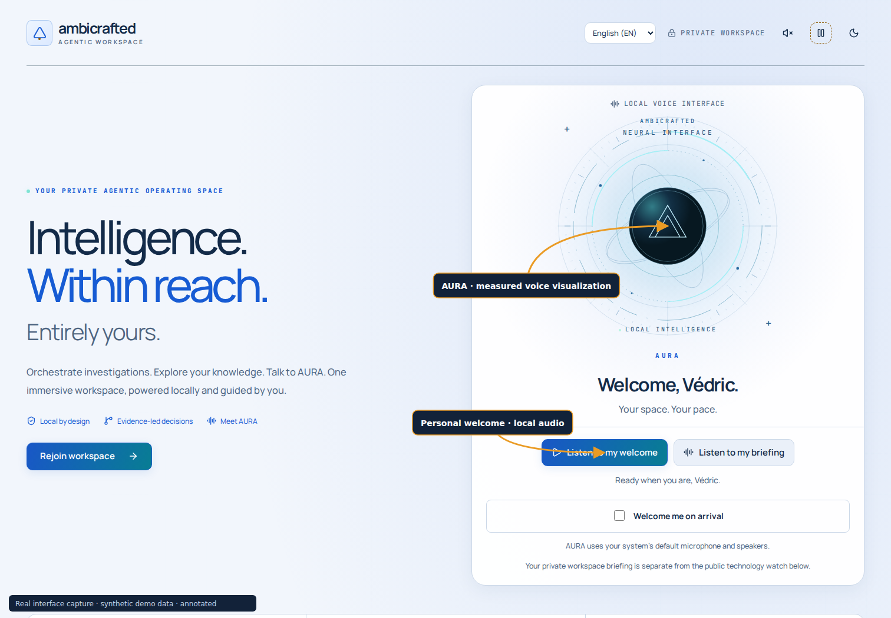
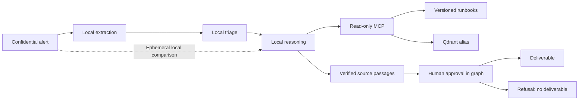

# Ambicrafted · Agentic workspace

A local workstation platform for read-only SRE analysis. All incident data,
including model-derived extracts, stays on the local model path. The gateway
also exposes external aliases for separate public or synthetic workloads.

The September 2026 hardening is recorded in
[ADR 0009](docs/adr/0009-garanties-verifiables-apres-audit.md).
The [delivery assessment](docs/RELEASE-2026-09-26.md) records the completed
features, measured acceptance checks and remaining production conditions.
Historical ADRs describe earlier behavior and measurements; the current
contracts below take precedence.

Console **0.5.0**, control API **0.5.0**, SRE workflow **0.2.0**, local speech
runtime **0.3.3**. The [22 October qualification](docs/QUALIFICATION-2026-10-22.md)
tracks this candidate, its validation and remaining conditions. This is a
private, single-operator workspace; it is not a multi-tenant commercial service
or a zero-vulnerability certification. Earlier
[delivery reports](docs/RELEASE-0.4.5.md) and the
[20 October qualification](docs/QUALIFICATION-2026-10-20.md) remain historical
evidence; their image and evaluation counts do not describe this candidate.

AURA supports [saved diagrams and structured reports](docs/AURA-ARTIFACTS.md),
including source references, SVG/PNG/JSON/Markdown exports and editable memory
drafts. Their local consistency review is fallible; generated material remains
a proposal for operator review. The expanded [User guide](docs/GUIDES.md) includes
local bilingual video lessons, optional captions and complete transcripts.

This version adds [saved conversations and documents](docs/CONVERSATIONS.md),
[dedicated graph memory](docs/MEMORY.md), the [NEXUS MCP gateway](docs/MCP-GATEWAY.md),
more natural bilingual speech with English technical pronunciation, and an original
quiet instrumental. Background music yields to AURA and mutes during recording.

[Documentation index](docs/README.md) · [First personal session](docs/PERSONAL-USE.md) · [Measured qualification](docs/QUALIFICATION-2026-10-22.md)

## Private console, CLI and voice

The private console runs at [http://127.0.0.1:8787](http://127.0.0.1:8787). Its responsive workspace
includes mission templates, supervised analyses, approvals, a runbook editor,
local semantic search, measured readiness, operational charts, an interactive
architecture guide, observability and maintenance operations. AURA is its local
AI voice/text assistant. The welcome page,
workspace, forms and navigation share the same visual design, keyboard controls,
light/dark themes and automatic motion. Fonts and browser assets are hosted locally.
Larger text and controls support reading across the workspace. Sections receive
finite entry accents when scrolling down or back up. Animations run automatically
and respect the operating system's reduced-motion accessibility setting. There
is no Motion on/off control; old persisted overrides are removed. Offscreen and
hidden-page animations pause to avoid inactive work. See the
[current motion and observability decision](docs/adr/0048-observabilite-correlee-et-mouvement.md).
Interface language is selectable between English and French, defaults to English,
and persists in the browser independently of AURA's conversation language.
The target remains one trusted operator on this workstation.

<picture>
  <source media="(prefers-color-scheme: dark)" srcset="docs/media/welcome-dark.png">
  
</picture>

These are actual browser captures with annotated arrows and **synthetic demo data**.
[Workspace and KPI view](docs/media/workspace-dark.png) ·
[AURA vertical workspace](docs/media/assistant-dark.png) ·
[Architecture and trust boundaries](docs/media/architecture-light.png) ·
[Appearance settings](docs/media/settings-light.png).
Capture hashes and provenance are recorded in [docs/media/provenance.json](docs/media/provenance.json).

```bash
# From the repository root, after the gateway and local models are configured:
uv sync --locked --all-extras --project agents/sre-agent
uv sync --locked --project mcp-servers/runbooks
uv sync --locked --project apps/control-api
uv sync --locked --project apps/voice
uv run --locked --project apps/voice voix-locale installer
cd apps/console
npm ci
npm run build
cd ../..
./plateforme installer-service --demarrer
./plateforme preparation
./plateforme ouvrir
```

`ouvrir` uses an expiring one-use ticket and never prints credentials. For future
entry directly from the welcome page, choose a password in **Settings → Console
password** after this first login, or run `./plateforme mot-de-passe`. Password
sign-in takes you straight to the workspace. Without a configured password, an
expired browser session needs another one-use CLI entry; CLI access remains available. Both UI and CLI use the same
authenticated control API; `./plateforme --help` documents every command.

AURA has a larger, centered vertical instrument, responsive layouts and plain
**English voice / French voice** choices. Input and output follow the operating
system defaults; old browser device selections are ignored. Change devices in
your OS settings. **Check microphone & sound** records up to eight seconds and
replays locally, without uploading the sample. Microphone access requires an
explicit action and browser permission. See [audio setup](docs/CONSOLE.md#microphone-sound-and-walkthroughs).
**User guide** contains six workflows in each language: twelve 1080p narrated
MP4s, four chapters per video, optional captions and complete transcripts.
AURA keeps its local speech models warm between exchanges, with an idle timeout
and cancellation cleanup; see [voice operation](docs/VOICE.md).

[Grafana monitoring](docs/MONITORING.md) offers six operational views in English
and French: service health, agentic activity, infrastructure, reliability and error
budgets, browser experience, and traces with metric correlation. It distinguishes
missing data from zero activity. See the [qualification and limits](docs/OBSERVABILITY-2026-10-21.md).
AURA now breathes, pulses and rotates continuously while visible, including Welcome
and Overview. Page entrances fade again in both scroll directions; reduced-motion
follows the operating system setting. Before starting a spoken conversation, the
local model is prepared without opening the microphone. Spoken turns end after a
brief pause and are limited to 30 seconds; manual recordings still allow 90 seconds.
Spoken replies favor one to three short sentences.

AURA offers synthetic English and French voices, with local CPU speech
recognition and playback. Manual recording lets you review the transcription.
An explicitly started hands-free conversation sends speech after a pause, reads
the reply and then listens for the next turn. Stop, Escape, hiding the tab or
leaving the page ends it. Conversation has no approval or execution authority;
use the analysis workflow for a sourced proposal.

See [console operations](docs/CONSOLE.md), [voice installation and licensing](docs/VOICE.md),
[local tools and readiness](docs/TOOLS.md) and the
[client mission walkthrough](docs/CLIENT-WORKFLOW.md).

Start in **Readiness**, inspect anything incomplete, then open **Missions**.
Choose among 18 presets spanning incident response, SRE, DevOps, DevSecOps, cloud
architecture, platform engineering, security, FinOps and agent evaluation; edit the brief
with observed facts before submitting it. These presets use the same bounded SRE
workflow. They do not deploy agents to client systems or create tenant isolation.

**Overview** charts use saved runs and current local health checks: activity over
7 or 14 UTC days, the states of retained runs, and service probe durations. Analyses
and maintenance operations share these aggregates; deleting a run removes its
contribution. Charts include keyboard inspection and a data table. Probe durations
are snapshots, not model inference latency or an availability SLO.

Open **Architecture** at `/architecture` to follow **Investigation**, **Voice**,
**Knowledge**, **Memory** or **Telemetry**. Select a component to inspect its role, data and
boundary, then open the relevant workspace. Animated connections explain the
design; only the separately identified health probes report measured availability.
See [the architecture guide](docs/ARCHITECTURE.md#operational-charts-and-interactive-map).

## Components

| Component | Purpose |
|---|---|
| LiteLLM + PostgreSQL | Gateway aliases, restricted virtual keys and accounting |
| Ollama | Local `coder` inference and document embeddings |
| Qdrant | Versioned runbook index behind `runbooks-current` |
| MCP runbooks | Four bounded, read-only tools |
| SRE loop / LangGraph | Local analysis; the graph adds durable human approval |
| Tempo, Prometheus, Grafana | Local traces, metrics, availability rules and dashboard |
| Local workflow qualification | 73 consumed synthetic regression cases through the real graph/MCP; no unseen holdouts remain; contracts and substantive review are distinct |
| React / FastAPI console | Authenticated local workspace, bounded jobs, SSE and approvals |
| Unified CLI / NEXUS MCP | Operator commands, 20 readiness checks, four runbook and eleven read-only control tools |
| Multilingual ONNX speech / faster-whisper | Offline English/French female speech and transcription on CPU |



A document name is insufficient evidence. An action must match a complete paragraph
actually read from that document. This verifies provenance, not
operational or contextual correctness. The operator still reviews relevance,
preconditions and risks. The agent never executes a remediation.

## Install

Reference workstation tools: Python 3.14.7 for the API/agent/MCP and 3.13.15
for speech, uv 0.13.4, Node 22.23.3, npm 11.10.0, Docker Compose, and Ollama
0.32.15. Use the project Python selectors and committed locks; do not substitute
the system Python or install packages globally. The local model needs the
GPU/RAM described in `CLAUDE.md`. A second-machine installation remains a
separate qualification exercise.

Put the installed `uv` on `PATH` before using the commands below. The platform
wrapper also recognizes its usual `~/.local/bin/uv` location. Install the managed
Python versions explicitly when preparing a new workstation:

```sh
export PATH="$HOME/.local/bin:$PATH"
uv python install 3.14.7 3.13.15
```

The qualified server target is Ubuntu 24.04 amd64, including WSL2 with systemd.
Document extraction requires bubblewrap, libseccomp2 and working Linux namespaces.
Install the [host prerequisites](docs/HOST-TOOLS.md), then run
`./plateforme prerequis` before starting or installing the console service.
The guide includes a verified private installer when administrator access is
unavailable and a pinned age installer for encrypted backup export.
Native Windows/macOS servers and a second machine are not yet qualified.
The dedicated Neo4j amd64 image requires an x86-64-v3 CPU.

1. Review [gateway setup](gateway/README.md), prepare its private environment
   from `gateway/.env.example`, and start the six core services. The monitoring exporter uses the optional
   `observability` profile; install its collector before starting it (see
   [Monitoring](docs/MONITORING.md)).
2. Provision the model from [models/](models/README.md). Verify model digests;
   model tags alone are mutable.
3. Create the root environment and restricted key without printing it:

```sh
uv run --locked scripts/plateforme.py creer-cles
# Edit other root settings if needed, then load them through direnv.
direnv allow
uv sync --locked --project agents/sre-agent --extra graphe
uv sync --locked --project mcp-servers/runbooks
uv run --locked --directory mcp-servers/runbooks indexer.py
uv run --locked scripts/plateforme.py verifier
```

The key command preserves existing keys. `--inclure-frontiere` additionally
creates an external-evaluation key; the SRE pipeline does not use it.
Complete the console/voice setup above after these core services are ready.
Dependency and model installation requires network access; inference remains
local. Voice installation is explicit and verifies pinned artifact hashes.

The checked-in `.mcp.json` configures one stdio entrypoint: NEXUS (`plateforme`).
It routes four source/search tools and eleven read-only operator tools from two
fixed backend profiles. Start the console API before using control tools and use the
checkout root as the MCP client's working directory. Keep keys out of the MCP
configuration. Connect confidential tools only to a trusted local consumer;
the server cannot control what a remote consumer later does with returned data.
Dedicated Neo4j memory is optional for SRE runbook analysis; its two read-only tools
require the separate memory service. No generic network/shell tool is exposed.

Run an analysis with synthetic input first:

```sh
uv run --locked --directory agents/sre-agent sre-agent 'PostgreSQL: too many clients already'
uv run --locked --directory agents/sre-agent --extra graphe sre-agent-graph 'PostgreSQL: too many clients already'
```

The graph exits with code 10 while awaiting approval. Its displayed resume
command includes the thread and checkpoint path. A refusal has code 4 and
no delivered diagnosis. The loop has no human gate: its report is a proposal
for an operator, never an automatic intervention.

## Operate and verify

```sh
uv run --locked scripts/sauvegarder.py
uv run --locked scripts/tester_restauration.py /path/to/private/backup
uv run --locked scripts/plateforme.py installer-retention
```

The last command installs daily **user** timers for local backups and cleanup
of checkpoints/backups older than 14 days. The user systemd manager must run;
missed calendar events are caught up through `Persistent=true`.

- [Architecture and boundaries](docs/ARCHITECTURE.md)
- [End-to-end client mission guide](docs/CLIENT-WORKFLOW.md)
- [Measured readiness and tool contracts](docs/TOOLS.md)
- [Security, including limitations](SECURITY.md)
- [Operations, recovery and retention](docs/OPERATIONS.md)
- [Agent contract](agents/sre-agent/README.md)
- [MCP and index lifecycle](mcp-servers/runbooks/README.md)
- [Evaluation scope](evals/README.md)
- [Contributing and checks](CONTRIBUTING.md)
- [Remaining dependency risks](docs/DEPENDENCIES.md)

The [current qualification](docs/QUALIFICATION-2026-10-22.md) records the tested
scope and remaining release gates. Private supervised use, functional CI,
vulnerability remediation and production acceptance are separate conclusions.
Readiness checks do not establish high availability, exhaustive incident coverage
or a vulnerability-free system. Historical security reports retain their original
dates and must not be used as current scan results.

License: Apache-2.0 for project code. Third-party components retain their own
licenses; see the [diagram layout notice](apps/console/public/notices/README.txt)
and [audio notices](apps/console/public/audio/NOTICE.md). The browser notices also
include the exact Manrope and JetBrains Mono font licenses. A source release does
not redistribute private runtime images, model weights or operator data.
