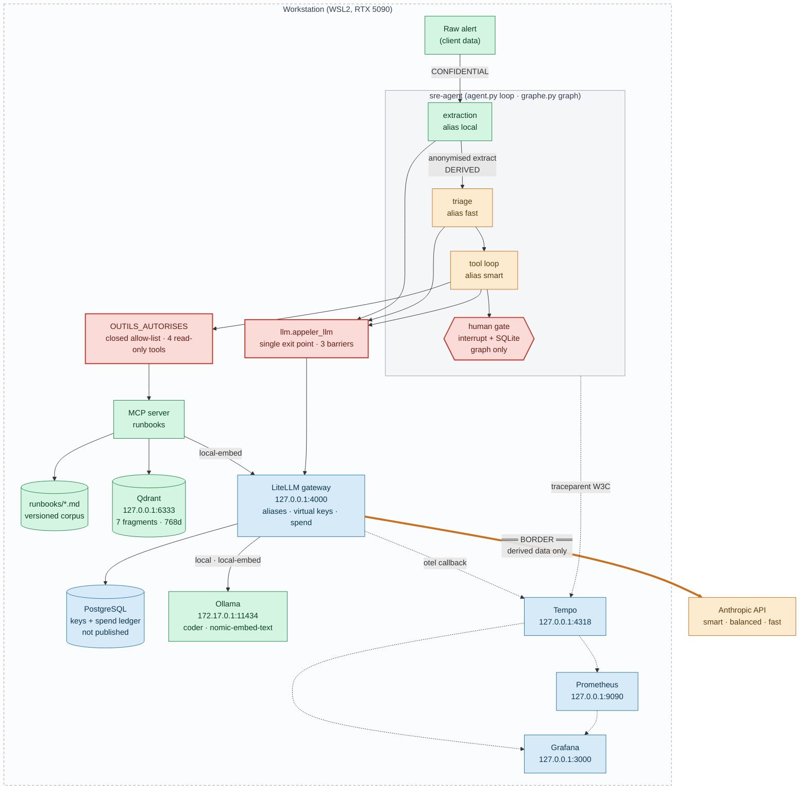

# AI Platform

[](https://github.com/Vedric/ambicrafted-platform-workspace/actions/workflows/ci.yml)
[](agents/sre-agent/pyproject.toml)
[](CONTRIBUTING.md)
[](gateway/docker-compose.yml)
[](agents/sre-agent/tests)
[](docs/adr/README.md)
[](LICENSE)
[](docs/OPERATIONS.md)

A single-workstation LLM platform built around one rule: **client data never
leaves the machine, and that is enforced by code paths rather than by prompts.**
It routes every model call through one gateway that speaks only in semantic
aliases, and it ships a bounded SRE agent that reads runbooks, cites them, and
stops: it has no tool that can change anything.

Every guardrail documented here was accepted only after a **refusal was
observed**: a test, a run, or a gateway response that actually said no.

## 🗺️ Architecture



**Legend**: the same four colours are used in every diagram of this repository
(see [`docs/ARCHITECTURE.md`](docs/ARCHITECTURE.md)):

| Colour | Meaning |
|---|---|
| 🟩 Green | **Local / confidential.** Raw client data, and everything that may see it. Never crosses the border. |
| 🟧 Amber | **Frontier.** Reaches an external provider. Only derived, anonymised data is ever routed here. |
| 🟦 Blue | **Infrastructure.** Gateway, storage, observability. Bound to `127.0.0.1` only. |
| 🟥 Red | **Guardrail.** A place where the code says no. Each one has an observed refusal. |

The thick amber edge is the only path out of the machine. It starts at the
gateway, never at the agent: the agent knows aliases, the gateway knows models.

## 🧩 Components

| Component | Role | Location |
|---|---|---|
| **LiteLLM gateway** | Single OpenAI-compatible entry point. Five semantic aliases (`smart`, `balanced`, `fast`, `local`, `local-embed`), virtual keys, per-key spend accounting. No fallback out of `local`. | [`gateway/`](gateway/) |
| **PostgreSQL** | Gateway-owned store: virtual keys (hashed) and spend history. Not published on the host. | `gateway/docker-compose.yml` (`litellm-db`) |
| **Ollama** | Local inference, outside Compose, on the host. Serves `local` (`coder`) and `local-embed` (`nomic-embed-text`). Reached from containers at `172.17.0.1:11434`, never `localhost`. | host service |
| **Qdrant** | Vector index of the runbook corpus. One collection, `runbooks`, 768 dimensions, cosine. | `gateway/docker-compose.yml` |
| **Tempo · Prometheus · Grafana** | Traces, metrics, dashboards. Tempo receives OTLP from both the agent and the gateway, on the same trace. | [`gateway/observability/`](gateway/observability/) |
| **MCP server `runbooks`** | Four read-only tools: `list_runbooks`, `read_runbook`, `search_runbooks` (regex), `semantic_search` (Qdrant). Every file access is confined to `RUNBOOK_DIR`. | [`mcp-servers/runbooks/`](mcp-servers/runbooks/) |
| **Runbook indexer** | Splits runbooks **by markdown section**, prefixes each fragment with its heading path, embeds through the gateway. Idempotent (collection recreated, UUIDv5 point ids). | `mcp-servers/runbooks/indexer.py` |
| **`sre-agent`** | The hand-written loop. Extract → triage → tool loop → diagnostic. Reference implementation. | `agents/sre-agent/src/sre_agent/agent.py` |
| **`sre-agent-graph`** | The same analysis as a LangGraph state graph, plus a durable human approval gate that survives `kill -9`. Optional extra. | `agents/sre-agent/src/sre_agent/graphe.py` |
| **Runbook corpus** | The operational knowledge itself, versioned as an asset of the repository. | [`runbooks/`](runbooks/) |
| **Eval harness** | promptfoo comparison of `local` against `balanced` on real SRE tasks, with an LLM judge. Uses the least-privileged virtual key. | [`evals/`](evals/) |
| **Secret hook** | `PreToolUse` hook on `Write`/`Edit`/`Bash` that refuses a literal secret. Deliberately narrow, see rule 8. | [`.claude/hooks/`](.claude/hooks/) |

## 🚀 Quick start

From nothing to an answered call. Steps are ordered; each assumes the previous.

**Prerequisites**: Docker Engine with Compose v2, [uv](https://docs.astral.sh/uv/),
[direnv](https://direnv.net/), and Ollama on the host with `coder` and
`nomic-embed-text` pulled. The subnet `172.28.0.0/24` and the ports `4000`,
`4318`, `9090`, `3000`, `6333` must be free on `127.0.0.1`.

```sh
# 1. Gateway secrets. Every value in the template is fake and must be replaced.
cd gateway
cp .env.example .env && chmod 600 .env
$EDITOR .env                       # never echo a secret back, see rule 8
docker compose config --quiet && echo OK

# 2. Bring the stack up. Compose orders it: postgres healthy, then litellm.
docker compose up -d               # first run: LiteLLM creates its schema
docker compose ps                  # 6 services Up; postgres and qdrant healthy

# 3. Create the two virtual keys. `confidential-only` is the compartment.
#    direnv loads the ROOT .env, not this one; load it without printing it.
set -a && . ./.env && set +a
curl -s localhost:4000/key/generate \
  -H "Authorization: Bearer $LITELLM_MASTER_KEY" -H "Content-Type: application/json" \
  -d '{"key_alias":"confidential-only","models":["local","local-embed"]}'
curl -s localhost:4000/key/generate \
  -H "Authorization: Bearer $LITELLM_MASTER_KEY" -H "Content-Type: application/json" \
  -d '{"key_alias":"orchestrator"}'
```

```sh
# 4. Workspace environment. Three variables, loaded by direnv, never committed.
cd ..                              # repository root
cat > .env <<'EOF'
LITELLM_BASE_URL=http://localhost:4000/v1
CONFIDENTIAL_KEY=                  # paste the confidential-only key
ORCHESTRATOR_KEY=                  # paste the orchestrator key
EOF
chmod 600 .env && direnv allow

# 5. Index the runbook corpus into Qdrant.
uv run --directory mcp-servers/runbooks indexer.py --dry-run   # shows the split
uv run --directory mcp-servers/runbooks indexer.py             # writes to Qdrant

# 6. Run the agent.
cd agents/sre-agent
uv run sre-agent "[CRITICAL] PostgreSQL: FATAL: sorry, too many clients already"
```

Expected: a triage line, a diagnostic sourced on `incident-p1-database.md`,
the tools that were called, and the budget spent. Exit code `0` on a complete
analysis, `2` on an exhausted budget, `3` on an execution error.

The graph variant stops before delivering and waits for a human:

```sh
uv run --extra graphe sre-agent-graph "[CRITICAL] PostgreSQL: too many clients already"
# → exit code 10, prints a thread id. The process may now be killed.
uv run --extra graphe sre-agent-graph --thread-id <id> --reprendre oui
```

**Verification without the stack**: the guardrails are tested on an unplugged
machine. No gateway, no MCP server, no network:

```sh
cd agents/sre-agent && uv run --extra graphe pytest -q   # 49 passed
bash ../../.claude/hooks/test-block-secrets.sh           # 15 checks, both directions
```

## 🔒 Security by construction

The claim of this project is not that the agent is well-behaved. It is that the
agent **cannot** misbehave in seven specific ways, because a code path refuses,
and that each refusal has been observed rather than reasoned about.

| # | Control | Where it lives | Observed refusal |
|---|---|---|---|
| 1 | **Tool-call budget** | `budget.py` | `SRE_MAX_APPELS_OUTILS=2` → clean stop on the 3rd tool, exit code `2`, no diagnostic. The counter is decremented **before** execution, so the refused call never reaches the server. |
| 2 | **Monetary budget** | `budget.py` | `SRE_MAX_COUT_USD=0.05` → exit code `2`. Cost is charged from what the gateway reports, so the agent holds no price table and needs no model name. |
| 3 | **Read-only by absence of tool** | `outils.py` | `ecrire_runbook` → `"Refusé : … n'est pas un outil de cet agent"`, returned before the MCP session is even consulted. There is no shell, no file write, no arbitrary HTTP anywhere in the package. |
| 4 | **Data compartmentalisation** | `llm.py`, `config.py`, `gateway/config.yaml` | Confidential payload aimed at a frontier alias → `FuiteConfidentielle` raised with **zero network calls attempted** and zero cost. Independently, the gateway answered `key not allowed to access model` on a `confidential-only` → `smart` attempt (2026-08-24). |
| 5 | **Untrusted-data confinement** | `prompts.py` | A forged closing marker does not close the block: the only valid one carries a per-run random token the alert author cannot guess. An injection-bearing alert was **reported, not followed**, and the hostile text stayed local: the triage payload never contains it. |
| 6 | **Source guard** | `modeles.py` | A diagnostic declaring `runbook_source: null` has its actions **removed** from `actions_proposees`, moved to `actions_ecartees_sans_source`, and replaced by a human escalation. Observed on an out-of-corpus TLS alert: no procedure was invented. |
| 7 | **Durable human gate** | `graphe.py` | The graph writes its full state and stops **before** delivering. Silence is not approval: an empty answer yields `rejete_par_humain` and nothing is delivered. The process was `SIGKILL`ed during the pause; a fresh process resumed on the same thread id in **1.28 s for 0.00 USD**, context intact. |

Two further controls exist but do not take the shape of a refusal, and are
listed separately rather than padded into the seven:

- **Traceability** (`tracage.py`) is an observation control, not a refusal. One
  parent span per run, one child span per LLM call and per tool call, with
  `gen_ai.*` plus `ambicrafted.*` attributes carrying data classification,
  cost, alias and outcome. Since ADR 0005 the gateway's own spans attach under
  the agent's, so one alert is one trace. Tracing never fails the agent: if
  Tempo is unreachable, the export fails in its background thread and the
  analysis continues.
- **Deserialisation allow-list** (`graphe.py`) closes a surface the framework
  itself opened: `TYPES_PERSISTABLES` with `pickle_fallback=False` restricts
  what the SQLite checkpoint may rebuild. It is a real control, but no test
  currently exercises its refusal, stated here rather than claimed.

Three properties hold across all of it: **the code never names a provider
model**, only aliases; **secrets are never displayed, even to check them**
(length and 12-character prefix only, ADR 0007); and **the guardrails were not
rewritten for the graph port**: the same five modules are imported unchanged,
which is what makes the ADR 0004 comparison mean anything.

Full threat model, including what is explicitly **not** covered:
[`SECURITY.md`](SECURITY.md).

## 📚 Documentation map

| Document | What it answers |
|---|---|
| [`docs/ARCHITECTURE.md`](docs/ARCHITECTURE.md) | How a request flows end to end, the graph, the RAG pipeline, network topology, data model. |
| [`SECURITY.md`](SECURITY.md) | Threat model, the seven controls, secret handling, how to report a vulnerability. |
| [`CONTRIBUTING.md`](CONTRIBUTING.md) | Conventions, dev setup, the nine project rules, the language policy. |
| [`docs/OPERATIONS.md`](docs/OPERATIONS.md) | Runbook: start, stop, health, secret rotation, checkpoint purge, reindexing, troubleshooting. |
| [`docs/adr/README.md`](docs/adr/README.md) | Index of the eight architecture decision records. |
| [`gateway/README.md`](gateway/README.md) | Rebuilding the stack from scratch, image pinning, secret rotation. |
| [`agents/sre-agent/README.md`](agents/sre-agent/README.md) | The agent itself: guardrails, output contract, configuration. |
| [`mcp-servers/runbooks/README.md`](mcp-servers/runbooks/README.md) | The MCP server and the indexer. |
| [`evals/README.md`](evals/README.md) | The promptfoo harness and why it uses the least-privileged key. |
| [`CLAUDE.md`](CLAUDE.md) | The operating contract for coding agents working in this repository. |

## ⚖️ Licence

Licensed under the [Apache License 2.0](LICENSE). You may use, modify and
redistribute this code, including commercially, provided you keep the licence
and copyright notice, state the changes you made, and do not use the author's
name or marks to endorse your derivative. The licence also grants an explicit
patent licence, and it terminates for anyone who starts patent litigation over
this work. The code is provided **as is**, without warranty, which is the
whole of section 7 and worth reading before running an agent against your own
infrastructure.
