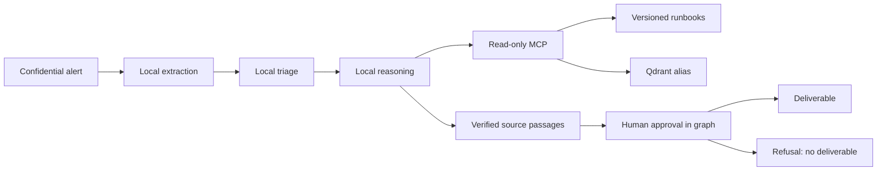

# Ambicrafted · Agentic workspace

A local workstation platform for read-only SRE analysis. All incident data,
including model-derived extracts, stays on the local model path. The gateway
also exposes external aliases for separate public or synthetic workloads.

The September 2026 hardening is recorded in
[ADR 0009](docs/adr/0009-garanties-verifiables-apres-audit.md).
The [delivery assessment](docs/RELEASE-2026-09-26.md) records the completed
features, measured acceptance checks and remaining production conditions.
Historical ADRs describe earlier behavior and measurements; the current
contracts below take precedence.

## Private console, CLI and voice

The production console runs on `http://127.0.0.1:8787`. It includes supervised
analyses, approvals, a runbook editor, local semantic search, observability,
maintenance operations and an ephemeral voice/text assistant. All fonts and
browser assets are hosted locally. The default target is one trusted operator
on this workstation, as explicitly selected by the owner.

```bash
# From the repository root, after the gateway and local models are configured:
uv sync --locked --all-extras --project agents/sre-agent
uv sync --locked --project apps/control-api
uv sync --locked --project apps/voice
uv run --locked --project apps/voice voix-locale installer
cd apps/console
npm ci
npm run build
cd ../..
./plateforme installer-service --demarrer
./plateforme ouvrir
```

`ouvrir` uses an expiring one-use ticket and never prints credentials. Alternatively,
configure a password with `./plateforme mot-de-passe`. Both UI and CLI use the same
authenticated control API; `./plateforme --help` documents every command.

The French feminine voice and microphone transcription run locally on CPU.
Review the transcription before sending it. Conversation has no approval or
execution authority; use the analysis workflow for a sourced proposal.

See [console operations](docs/CONSOLE.md), [voice installation and licensing](docs/VOICE.md),
[ADR 0010](docs/adr/0010-console-et-plan-de-controle.md) and
[ADR 0011](docs/adr/0011-voix-locale-et-outils-de-controle.md).

## Components

| Component | Purpose |
|---|---|
| LiteLLM + PostgreSQL | Gateway aliases, restricted virtual keys and accounting |
| Ollama | Local `coder` inference and document embeddings |
| Qdrant | Versioned runbook index behind `runbooks-current` |
| MCP runbooks | Four bounded, read-only tools |
| SRE loop / LangGraph | Local analysis; the graph adds durable human approval |
| Tempo, Prometheus, Grafana | Local traces, metrics, availability rules and dashboard |
| promptfoo | Synthetic model evaluations, with a local-only configuration |
| React / FastAPI console | Authenticated local workspace, bounded jobs, SSE and approvals |
| Unified CLI / control MCP | Operator commands and three read-only control tools |
| Piper / faster-whisper | Offline French feminine speech and transcription on CPU |



A document name is insufficient evidence. An action must match a complete paragraph
actually read from that document. This verifies provenance, not
operational or contextual correctness. The operator still reviews relevance,
preconditions and risks. The agent never executes a remediation.

## Install

Validated workstation tools: Python 3.14.7, uv 0.12.5, Node 22.22.0,
npm 11.10.0, Docker Compose, and Ollama 0.32.15. The local model needs the
GPU/RAM described in `CLAUDE.md`. A second-machine installation remains a
separate qualification exercise.

1. Review [gateway setup](gateway/README.md), prepare its private environment
   from `gateway/.env.example`, and start the six services.
2. Provision the model from [models/](models/README.md). Verify model digests;
   model tags alone are mutable.
3. Create the root environment and restricted key without printing it:

```sh
uv run --locked scripts/plateforme.py creer-cles
# Edit other root settings if needed, then load them through direnv.
direnv allow
uv sync --locked --project agents/sre-agent --extra graphe
uv sync --locked --project mcp-servers/runbooks
uv run --locked --directory mcp-servers/runbooks indexer.py
uv run --locked scripts/plateforme.py verifier
```

The key command preserves existing keys. `--inclure-frontiere` additionally
creates an external-evaluation key; the SRE pipeline does not use it.

Run an analysis with synthetic input first:

```sh
uv run --locked --directory agents/sre-agent sre-agent 'PostgreSQL: too many clients already'
uv run --locked --directory agents/sre-agent --extra graphe sre-agent-graph 'PostgreSQL: too many clients already'
```

The graph exits with code 10 while awaiting approval. Its displayed resume
command includes the thread and checkpoint path. A refusal has code 4 and
no delivered diagnosis. The loop has no human gate: its report is a proposal
for an operator, never an automatic intervention.

## Operate and verify

```sh
uv run --locked scripts/sauvegarder.py
uv run --locked scripts/tester_restauration.py /path/to/private/backup
uv run --locked scripts/plateforme.py installer-retention
```

The last command installs daily **user** timers for local backups and cleanup
of checkpoints/backups older than 14 days. The user systemd manager must run;
missed calendar events are caught up through `Persistent=true`.

- [Architecture and boundaries](docs/ARCHITECTURE.md)
- [Security, including limitations](SECURITY.md)
- [Operations, recovery and retention](docs/OPERATIONS.md)
- [Agent contract](agents/sre-agent/README.md)
- [MCP and index lifecycle](mcp-servers/runbooks/README.md)
- [Evaluation scope](evals/README.md)
- [Contributing and checks](CONTRIBUTING.md)
- [Remaining dependency risks](docs/DEPENDENCIES.md)

The project is intended for a local workstation. It does not claim high
availability, exhaustive incident coverage, or freedom from upstream image
vulnerabilities. Dependencies are pinned and scanned; findings are tracked
rather than hidden behind a green functional test suite.

License: Apache-2.0.
