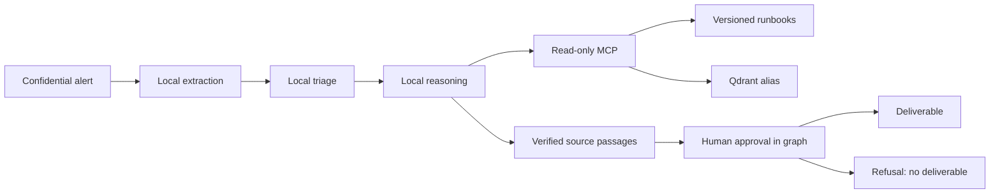

# Ambicrafted · Agentic workspace

A local workstation platform for read-only SRE analysis. All incident data,
including model-derived extracts, stays on the local model path. The gateway
also exposes external aliases for separate public or synthetic workloads.

The September 2026 hardening is recorded in
[ADR 0009](docs/adr/0009-garanties-verifiables-apres-audit.md).
The [delivery assessment](docs/RELEASE-2026-09-26.md) records the completed
features, measured acceptance checks and remaining production conditions.
Historical ADRs describe earlier behavior and measurements; the current
contracts below take precedence.

Current console/control release: **0.3.0**; local speech runtime: **0.2.0**.
See the [2026-09-27 delivery review](docs/RELEASE-2026-09-27.md).

## Private console, CLI and voice

The private console runs at [http://127.0.0.1:8787](http://127.0.0.1:8787). Its responsive workspace
includes mission templates, supervised analyses, approvals, a runbook editor,
local semantic search, measured readiness, observability and maintenance
operations. AURA is its local AI voice/text assistant. The welcome page,
workspace, forms and navigation share the same visual design, keyboard controls,
light/dark themes and pausable motion. Fonts and browser assets are hosted locally.
Interface language is selectable between English and French, defaults to English,
and persists in the browser independently of AURA's conversation language.
The target remains one trusted operator on this workstation.

```bash
# From the repository root, after the gateway and local models are configured:
uv sync --locked --all-extras --project agents/sre-agent
uv sync --locked --project mcp-servers/runbooks
uv sync --locked --project apps/control-api
uv sync --locked --project apps/voice
uv run --locked --project apps/voice voix-locale installer
cd apps/console
npm ci
npm run build
cd ../..
./plateforme installer-service --demarrer
./plateforme preparation
./plateforme ouvrir
```

`ouvrir` uses an expiring one-use ticket and never prints credentials. Alternatively,
configure a password with `./plateforme mot-de-passe`. Both UI and CLI use the same
authenticated control API; `./plateforme --help` documents every command.

AURA offers female synthetic English and French voices, with local CPU speech
recognition and playback. Manual recording lets you review the transcription.
An explicitly started hands-free conversation sends speech after a pause, reads
the reply and then listens for the next turn. Stop, Escape, hiding the tab or
leaving the page ends it. Conversation has no approval or execution authority;
use the analysis workflow for a sourced proposal.

See [console operations](docs/CONSOLE.md), [voice installation and licensing](docs/VOICE.md),
[local tools and readiness](docs/TOOLS.md) and the
[client mission walkthrough](docs/CLIENT-WORKFLOW.md).

Start in **Readiness**, inspect anything incomplete, then open **Missions**.
Choose incident, performance, capacity or change investigation; edit the brief
with observed facts before submitting it. These presets use the same bounded SRE
workflow. They do not deploy agents to client systems or create tenant isolation.

## Components

| Component | Purpose |
|---|---|
| LiteLLM + PostgreSQL | Gateway aliases, restricted virtual keys and accounting |
| Ollama | Local `coder` inference and document embeddings |
| Qdrant | Versioned runbook index behind `runbooks-current` |
| MCP runbooks | Four bounded, read-only tools |
| SRE loop / LangGraph | Local analysis; the graph adds durable human approval |
| Tempo, Prometheus, Grafana | Local traces, metrics, availability rules and dashboard |
| promptfoo | Synthetic model evaluations, with a local-only configuration |
| React / FastAPI console | Authenticated local workspace, bounded jobs, SSE and approvals |
| Unified CLI / control MCP | Operator commands, 19 readiness checks and nine read-only control tools |
| Piper / faster-whisper | Offline English/French female speech and transcription on CPU |



A document name is insufficient evidence. An action must match a complete paragraph
actually read from that document. This verifies provenance, not
operational or contextual correctness. The operator still reviews relevance,
preconditions and risks. The agent never executes a remediation.

## Install

Reference workstation tools: Python 3.14.7 for the API/agent/MCP and 3.13.15
for speech, uv 0.12.5, Node 22.22.0, npm 11.10.0, Docker Compose, and Ollama
0.32.15. Use the project Python selectors and committed locks; do not substitute
the system Python or install packages globally. The local model needs the
GPU/RAM described in `CLAUDE.md`. A second-machine installation remains a
separate qualification exercise.

Put the installed `uv` on `PATH` before using the commands below. The platform
wrapper also recognizes its usual `~/.local/bin/uv` location. Install the managed
Python versions explicitly when preparing a new workstation:

```sh
export PATH="$HOME/.local/bin:$PATH"
uv python install 3.14.7 3.13.15
```

1. Review [gateway setup](gateway/README.md), prepare its private environment
   from `gateway/.env.example`, and start the six services.
2. Provision the model from [models/](models/README.md). Verify model digests;
   model tags alone are mutable.
3. Create the root environment and restricted key without printing it:

```sh
uv run --locked scripts/plateforme.py creer-cles
# Edit other root settings if needed, then load them through direnv.
direnv allow
uv sync --locked --project agents/sre-agent --extra graphe
uv sync --locked --project mcp-servers/runbooks
uv run --locked --directory mcp-servers/runbooks indexer.py
uv run --locked scripts/plateforme.py verifier
```

The key command preserves existing keys. `--inclure-frontiere` additionally
creates an external-evaluation key; the SRE pipeline does not use it.
Complete the console/voice setup above after these core services are ready.
Dependency and model installation requires network access; inference remains
local. Voice installation is explicit and verifies pinned artifact hashes.

The checked-in `.mcp.json` configures exactly two stdio servers: `runbooks`
(four source/search tools) and `plateforme-controle` (nine read-only operator
tools). Start the console API before using the control adapter and use the
checkout root as the MCP client's working directory. Keep keys out of the MCP
configuration. Connect confidential tools only to a trusted local consumer;
the server cannot control what a remote consumer later does with returned data.
No Neo4j service or generic network/shell tool is required by this workflow.

Run an analysis with synthetic input first:

```sh
uv run --locked --directory agents/sre-agent sre-agent 'PostgreSQL: too many clients already'
uv run --locked --directory agents/sre-agent --extra graphe sre-agent-graph 'PostgreSQL: too many clients already'
```

The graph exits with code 10 while awaiting approval. Its displayed resume
command includes the thread and checkpoint path. A refusal has code 4 and
no delivered diagnosis. The loop has no human gate: its report is a proposal
for an operator, never an automatic intervention.

## Operate and verify

```sh
uv run --locked scripts/sauvegarder.py
uv run --locked scripts/tester_restauration.py /path/to/private/backup
uv run --locked scripts/plateforme.py installer-retention
```

The last command installs daily **user** timers for local backups and cleanup
of checkpoints/backups older than 14 days. The user systemd manager must run;
missed calendar events are caught up through `Persistent=true`.

- [Architecture and boundaries](docs/ARCHITECTURE.md)
- [End-to-end client mission guide](docs/CLIENT-WORKFLOW.md)
- [Measured readiness and tool contracts](docs/TOOLS.md)
- [Security, including limitations](SECURITY.md)
- [Operations, recovery and retention](docs/OPERATIONS.md)
- [Agent contract](agents/sre-agent/README.md)
- [MCP and index lifecycle](mcp-servers/runbooks/README.md)
- [Evaluation scope](evals/README.md)
- [Contributing and checks](CONTRIBUTING.md)
- [Remaining dependency risks](docs/DEPENDENCIES.md)

The [security review dated 26 September 2026](docs/SECURITY-RELEASE-2026-09-26.md)
records **166 remaining HIGH package occurrences** in the promoted images.
Continued supervised use in the existing private workstation scope has a
**conditional GO**. Unqualified production security sign-off, remote exposure
and mutually untrusted users remain **NO-GO** under that assessment. Readiness
checks and green functional tests do not resolve those findings or establish
high availability, exhaustive incident coverage or a vulnerability-free system.
Reassess the dated findings against a fresh scan before expanding the scope.

License: Apache-2.0.
