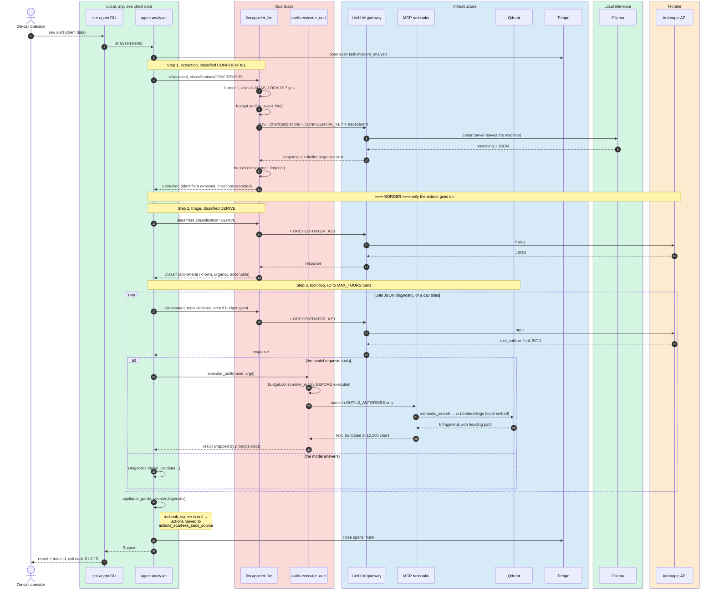
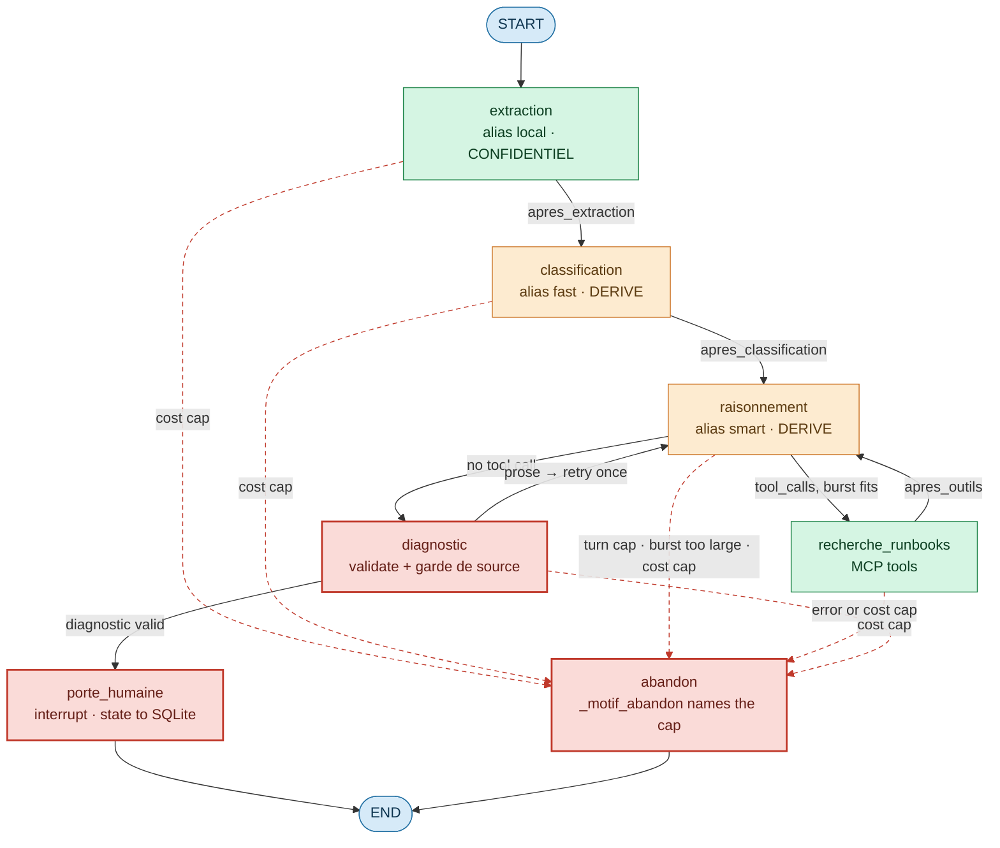
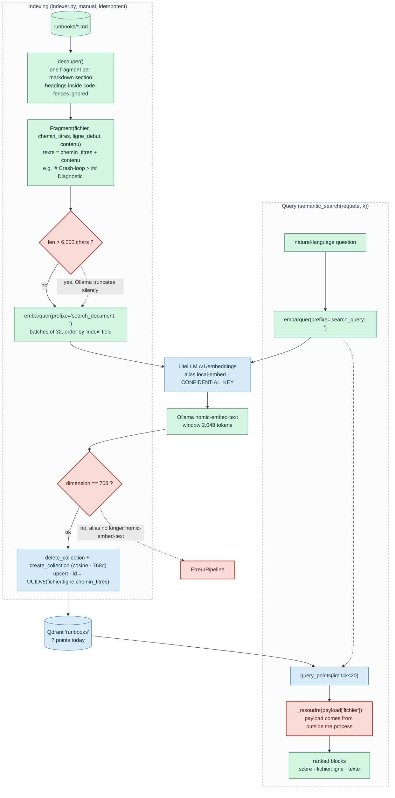

# Architecture

How the platform is put together, and how a request actually flows through
it. Everything documented here was read in the code or observed in execution;
where a behaviour is not verified, it says so.

Companion documents: [`SECURITY.md`](../SECURITY.md) for the threat model,
[`OPERATIONS.md`](OPERATIONS.md) for running it, [`adr/`](adr/README.md) for
why each choice was made.

## 🎨 The colour code

Four colours, used identically in every diagram of this repository. They
encode **where data is allowed to be**, not what a component is made of.

| Colour | `classDef` | Meaning |
|---|---|---|
| 🟩 Green | `local` | Local / confidential. Raw client data, and everything allowed to see it. Never crosses the border. |
| 🟧 Amber | `frontier` | Frontier. Reaches an external provider. Only derived, anonymised data is routed here. |
| 🟦 Blue | `infra` | Infrastructure. Gateway, storage, observability. Bound to `127.0.0.1` only. |
| 🟥 Red | `guard` | Guardrail. A place where the code says no, with an observed refusal. |

```
classDef local    fill:#d5f5e3,stroke:#1e8449,stroke-width:1px,color:#0b3d20
classDef frontier fill:#fdebd0,stroke:#ca6f1e,stroke-width:1px,color:#5b3a10
classDef infra    fill:#d6eaf8,stroke:#2874a6,stroke-width:1px,color:#0e3550
classDef guard    fill:#fadbd8,stroke:#c0392b,stroke-width:2px,color:#641e16
```

The rule that makes the green/amber split decidable is a strict partition in
`config.py`: `ALIAS_LOCAUX = {local, local-embed}` and
`ALIAS_FRONTIERE = {smart, balanced, fast}`. A test asserts the two sets stay
disjoint; without that, the compartmentalisation guard would be
interpretable rather than computable.

## 🔄 One alert, end to end

The hand-written loop (`agent.py`). Boxes group participants by colour class.



Two properties are visible in the ordering and are worth stating explicitly,
because they are what the tests lock:

- **Barrier 1 precedes everything network-related.** The classification check
  happens before the budget check, before the span, before the headers are
  even built. A refused payload never gets an `Authorization` header and
  never gets a `traceparent` (verified in
  `tests/test_propagation_trace.py::test_le_refus_precede_l_injection_et_le_reseau`).
- **The tool budget is charged before execution.** A refused tool call never
  reaches the MCP server (verified in
  `tests/test_gardefous.py::test_le_budget_est_decompte_avant_execution`).

The graph implementation (`graphe.py`) produces the **same `Rapport` object**
through the same five guardrail modules; only the orchestration differs, plus
one extra step, the human gate, described below.

## 🕸️ The LangGraph state graph

Seven nodes, five conditional edges. Every routing function is a pure
function of the state, which is why budget decisions are testable without
executing anything.



**What the dashed red edges mean.** Every one of them is a cap being opposed
*by the edge*, that is, **before entering the node**. This is one of the two
deliberate behavioural differences from the hand-written loop: a burst of
three tools requested when two remain is refused as a whole, where the loop
would have executed two and then raised. Both stop without a partial result;
the graph simply stops earlier. `outils.executer_outil` keeps its own check
and remains authoritative if an edge ever let something through.

**The gate is the point of the port.** `porte_humaine` calls `interrupt()`:
LangGraph writes the complete state to SQLite and hands control back *before*
the diagnostic is delivered. The process may then be killed. A later resume
on the same `thread_id` with `Command(resume=…)` picks up exactly there,
measured at 1.28 s for 0.00 USD, budget and tool history intact (ADR 0004).
Silence is not approval: `_lire_decision` treats anything that is not an
explicit agreement as a refusal.

**The abandonment reason is reconstructed, not carried.** The routing edge
knows why it routes but does not say so, therefore `_motif_abandon()` replays
the conditions in the node to name the right cap. ADR 0004 records this as a
cost of the declarative model: decision and explanation live in two places
and can diverge. A test locks the attribution.

## 🔍 The RAG pipeline

Two paths through the same embedding model, with **asymmetric task prefixes**:
nomic-embed-text is trained for that, and omitting them measurably degrades
recall on rephrasing.



Four design points that are load-bearing rather than incidental:

1. **Chunking by section, never by character count.** A fixed-size split
   returns "2. daemon-reload, reset-failed, restart" without step 1. During
   an incident a fragment of a procedure is more dangerous than no result,
   because it looks complete (ADR 0002).
2. **The heading path is part of the embedded text.** Without it a
   "## Diagnostic" fragment is indistinguishable between the systemd runbook
   and the PostgreSQL runbook, both when embedding and when displaying.
3. **Embeddings go through the gateway, never straight to Ollama**, with
   `CONFIDENTIAL_KEY` rather than the master key. A direct call would bypass
   the routing, the spend tracking and the compartmentalisation of ADR 0001.
   The search query therefore does not leave the machine either.
4. **Degradation never raises.** If Qdrant, the gateway or the dependency is
   missing, `semantic_search` returns a message naming the cause, giving the
   fixing command and pointing back to `search_runbooks`. An unavailable RAG
   brick must not take down the three tools that only need the file system.

**Known gap in the trace.** The MCP server calls `/v1/embeddings` from its own
process with its own `httpx` and no OpenTelemetry. That call produces an
orphan `litellm-gateway` trace, contained in the window of the
`tool.semantic_search` span but not attached to it. `tool.semantic_search`
therefore stays a leaf in the unified trace. ADR 0005 documents this as out
of scope, together with the `mcp` SDK's own root spans.

## 🌐 Network topology

Everything published is bound to the loopback interface. Nothing in this
stack listens on `0.0.0.0`.

| Service | Container | Published on the host | In-network address | Reached by |
|---|---|---|---|---|
| LiteLLM | `litellm` | `127.0.0.1:4000` | `litellm:4000` | agent, indexer, MCP server, evals |
| PostgreSQL | `litellm-db` | **not published** | `postgres:5432` | LiteLLM only |
| Tempo | `tempo` | `127.0.0.1:4318` (OTLP/HTTP) | `tempo:4318` OTLP/HTTP, `tempo:4317` OTLP/gRPC, `tempo:3200` API | agent (HTTP), gateway (gRPC), Grafana (API) |
| Prometheus | `prometheus` | `127.0.0.1:9090` | `prometheus:9090` | Tempo remote write, Grafana |
| Grafana | `grafana` | `127.0.0.1:3000` | `grafana:3000` | the operator |
| Qdrant | `qdrant` | `127.0.0.1:6333` | `qdrant:6333` | indexer, MCP server |

**Compose network**: `gateway_default`, subnet fixed at `172.28.0.0/24`,
chosen outside the ranges already in use (ADR 0001).

**Container addresses are not stable.** They are handed out in start order
and change at the first `docker compose up` that recreates a container.
Nothing in this repository may hard-code one. A default of
`http://172.28.0.3:4318` in `config.py` did exactly that and silently pointed
the agent's trace export at Grafana instead of Tempo; it now defaults to
`http://127.0.0.1:4318`, which is published and stable. The symptom and the
diagnosis are in
[`OPERATIONS.md`](OPERATIONS.md#traces-are-not-arriving-in-tempo).

**Ollama is not in Compose.** It runs on the host. Containers reach it at
`http://172.17.0.1:11434`, the Docker bridge address, never `localhost`,
which inside a container means the container itself.

**Two paths cross the border**, and only two: the gateway to the Anthropic
API for the `smart` / `balanced` / `fast` aliases. The agent has no path of
its own; it knows aliases, and only the gateway knows which model an alias
resolves to.

## 🗃️ Data model

### What the agent returns

`Rapport` (`modeles.py`) is the contract, identical for both
implementations. The diagnostic alone is unverifiable; what makes it
auditable is what surrounds it.

| Field | Type | Role |
|---|---|---|
| `statut` | `str` | `complet` · `budget_epuise` · `erreur` · `en_attente_humain` · `rejete_par_humain` |
| `extraction` | `Extraction \| None` | anonymised form of the alert; the only shape allowed across the border |
| `classification` | `ClassificationAlerte \| None` | known, urgency 1–5, actionable |
| `diagnostic` | `Diagnostic \| None` | probable cause, confidence, missing elements, proposed actions, `runbook_source` |
| `actions_ecartees_sans_source` | `list[str]` | actions the code removed for lack of a source |
| `injections_signalees` | `list[str]` | injection attempts recorded in the alert, reported, never followed |
| `outils_appeles` | `list[str]` | in call order, repeats included |
| `budget` | `dict` | tools used/cap, LLM calls, USD spent/cap, tokens |
| `trace_id` | `str \| None` | the trace to open in Grafana |
| `message` | `str` | why it stopped, or the pending approval request |

`Diagnostic.runbook_source` is `str | None`, nullable on purpose. A model
required to give a source invents one; a model allowed to say it has none
gives the most useful line of the report. `appliquer_garde_source` then acts
on that declaration rather than on the prose.

### Graph state and checkpoints

`EtatSRE` is a `TypedDict`, and above all it is **serialisable**: anything
that must survive the death of the process is in it. The MCP session and the
HTTP client are not: they are process resources, re-established on resume.

Six fields are accumulators annotated with `operator.add`: `messages`,
`outils_appeles`, `injections_signalees`, `actions_ecartees_sans_source`,
`journal`, `depenses`. Two nodes writing in the same super-step concatenate
instead of the last one overwriting the first, which matters even in a
sequential graph, because the `raisonnement → recherche_runbooks →
raisonnement` cycle writes into `messages` on every turn.

**The budget is stored as a list of deltas, not as a total.** A total would
be overwritten by the last branch to write; a list of deltas adds up.
`_budget()` replays them to rebuild the counter, which makes it as accurate
after a resume as it was before the interruption. The caps themselves always
come from `config`, and it is still `Budget` that opposes them on the next
real call.

| Fact about the checkpoint file | Value |
|---|---|
| Path | `~/.local/state/sre-agent/graphe.sqlite` (`SRE_CHECKPOINT_DB`) |
| Permissions | file `0600`, directory `0700`, it holds alert-derived data |
| Checkpoints per alert | 11 (ADR 0004) |
| On-disk volume per alert | ~110 KiB (ADR 0004) |
| Deserialisation | `JsonPlusSerializer(pickle_fallback=False, allowed_msgpack_modules=TYPES_PERSISTABLES)`, four named types |
| Retention | 14 days by default (`SRE_RETENTION_JOURS`), matching Tempo's 336 h |
| Purge | `sre-agent-graph --purger [--avant N] [--simulation]`, then `VACUUM` and WAL truncation |

The `VACUUM` and the WAL truncation are not tidiness: deleting rows leaves
the freed pages in the file and a copy in the write-ahead log, so
alert-derived data would survive its own "purge". A test asserts
`freelist_count == 0` and a zero-length `-wal` afterwards.

### Trace attributes

Standard `gen_ai.*` attributes, plus an `ambicrafted.*` namespace for what
the OTel semantic conventions do not cover.

| Attribute | Carries |
|---|---|
| `ambicrafted.data_classification` | `confidentiel` or `derive` |
| `ambicrafted.cost_usd` | cost of the span |
| `ambicrafted.task.type` | `incident_analysis`, `extraction`, `tool_call`, `graph_node`… |
| `ambicrafted.gateway.alias` | the alias aimed at, never a model name |
| `ambicrafted.outcome` | `complete`, `budget_exhausted`, `error`, `en_attente_humain`… |
| `ambicrafted.diagnostic.sourced` | whether the diagnostic cites a runbook |
| `ambicrafted.graph.path` | the nodes actually crossed, in order |
| `ambicrafted.resume.of_trace_id` | on a resume, the trace from before the interruption |

**Two aggregation traps** created by the unified trace, both documented in
ADR 0005 and both worth repeating because a dashboard will hit them:

1. Four `gen_ai.usage.*` keys are emitted identically by the agent and by the
   gateway. Any sum over a trace **without** a `resource.service.name` filter
   is wrong by a factor of exactly 2.
2. `gen_ai.request.model` means different things on each side: the alias on
   the agent's spans, the resolved provider model on the gateway's. That is
   not a defect: read by service, it is precisely how rule 1 becomes
   verifiable from Tempo.
