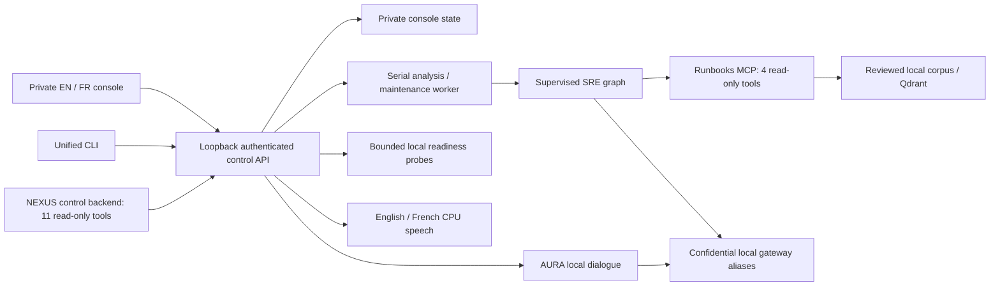

# Architecture

The workstation hosts a seven-service gateway/observability stack, optional
dedicated Neo4j memory, local Ollama, a runbook corpus, two MCP backends behind
the NEXUS stdio gateway, and two implementations of one read-only
incident-analysis workflow. The shared UI/CLI control API and local speech runtime
are described in ADR 0010–0015; incident guarantees are in ADR 0009. Older ADRs
remain historical records. [ADR 0017](adr/0017-indicateurs-flux-et-defilement.md)
specifies the operational charts, interactive map and scroll behavior.

## Operator workspace and control boundary

The React console and unified CLI use one authenticated FastAPI control service
on `127.0.0.1:8787`. The workspace includes overview, missions, AURA, analyses and
approvals, source editing/search, tool inventory, readiness, health,
observability, maintenance and settings. English/French interface selection
defaults to English and persists in browser storage; it changes UI text and
formatting without translating stored client content or changing voice language.
Locally served fonts/assets, responsive navigation, a keyboard command menu and
pausable/reduced motion apply throughout the interface.

The authenticated `/architecture` route adds an explorable guide to those
components. The overview's charts use the existing control API aggregates;
neither feature creates a new telemetry collector or expands tool permissions.

Mission templates are editable intake drafts for the same SRE analysis path.
Selecting one does not submit work, discover client infrastructure, deploy an
agent fleet or create a tenant. Source and hypothesis review remain human tasks.
The control service queues bounded work for one serial analysis/maintenance
worker, persists status and exposes authenticated progress/decision routes.
Explicit human approval is still required before a diagnostic is delivered.

Opaque browser sessions, a one-use CLI login ticket, CSRF/origin checks, bounded
requests and private state protect the local operator workflow. They are not a
remote identity system or authorization between mutually untrusted clients.
The browser and CLI can perform explicitly supported operator mutations; the
control MCP has a separate read-only surface, with no approval or execution tool.

## Operational charts and interactive map

The overview reads `/api/vue-ensemble`; the architecture page reads `/api/sante`
for its measured service indicators. Their definitions are deliberately separate:

| View | Data and interpretation |
| --- | --- |
| Saved-run activity | Counts of currently retained records by creation date, in UTC; the operator selects the last 7 or 14 days. Analyses and maintenance operations are both included. |
| Run states | Current retained records grouped into disjoint states: in progress, human review, completed, rejected, stopped, failed and any unknown future states. This distribution is not filtered by the activity-period selector. |
| Service response | Latest measured HTTP probe durations and explicit probe failures, refreshed approximately every 15 seconds while the page is active. The displayed refresh time describes the UI's successful data fetch. |

Deletion and retention remove records from both the activity and state aggregates.
These charts therefore cannot reconstruct an immutable workload history. A completed
maintenance operation is not a human-approved diagnosis, and a completion count
does not measure answer quality. Probe timings are not inference latency, historical
uptime or an SLO. Historical operational investigation remains in
Prometheus/Grafana/Tempo.

The activity plot has a keyboard-operable day selector and an expandable table;
state counts and service results also have textual labels. Empty data and failed
probes remain explicit. Native SVG and CSS render the views without adding a chart
service or sending the records elsewhere.

The architecture map provides four conceptual journeys:

| Journey | What the guide explains |
| --- | --- |
| Investigation | Authenticated intake, the supervised graph, source retrieval, local reasoning, checkpoints and human review. |
| Voice | Browser audio/text, the control boundary, local recognition, AURA dialogue, local synthesis and WAV playback. |
| Knowledge | Reviewed Markdown, local embeddings, versioned Qdrant publication and read-only source retrieval. |
| Telemetry | Gateway accounting, correlated spans, metric scraping and dashboard queries. |

Selecting a component displays its role, handled data, trust boundary and a link
to its workspace. A textual connection guide accompanies the diagram, and mobile
layouts expose the components as a selectable list. The paths and their animation
are explanatory, not live packets, active agents or observed traces.

Only components mapped to the six existing health endpoints display measured
response states. Components such as PostgreSQL and the human gate have no direct
probe in this view. A gateway response does not prove independent database
readiness. If health retrieval fails, the conceptual guide remains usable and
current availability is reported as unknown. Use Readiness for the broader
operational checklist.

## Readability and motion lifecycle

Menu, form, status and supporting text sizes have been increased using relative
units, with responsive layouts retained. Browser zoom remains available. Finite
scroll accents replay when eligible sections enter the viewport from either
direction; the page keeps native scrolling and a decorative progress indicator.
The animation does not change document layout or leave content hidden.

Scroll observation is bounded, uses viewport intersections and schedules progress
updates on demand. Focused content is not animated. Pause, reduced-motion changes,
hidden tabs and route cleanup cancel the relevant effects; the architecture's
animated connections also stop outside the viewport. These behaviors support
accessibility and limit inactive work, but do not constitute a universal frame-rate
or browser-compatibility guarantee. Final responsive, keyboard and accessibility
qualification is recorded against the integrated release commit.

## Readiness and local tools

`GET /api/preparation`, the Readiness page and `./plateforme preparation` /
`doctor` share one versioned response. Twenty checks measure installed runtime
metadata, entrypoints, private storage permissions, Linux API socket bindings,
configured local destinations, live permitted aliases, six health endpoints,
source/index availability, voice artifacts, actual MCP handshakes and a real
synthetic extraction inside the mandatory document sandbox. They run
independently under deadlines, share a short cache and return bounded evidence
without client content, credentials or raw exceptions. Suggested commands are
inert guidance, not automatic remediation.

The control MCP offers health, preparation, catalogue, analysis list/detail,
runbook list/read, search, bounded audit and graph-note list/detail. It can only call fixed authenticated
GET routes on loopback, rejects redirects, bounds response bodies and never
initializes missing configuration. Its read-only annotations describe the
restricted implementation; they do not enforce a consumer's subsequent use of
returned confidential data. Connect only trusted local consumers.

Passing readiness means measured operational prerequisites, not certified
provider routing behind an alias, fresh semantic content, inference correctness,
microphone quality or production security approval. See [TOOLS.md](TOOLS.md) and
[ADR 0014](adr/0014-readiness-et-outils-locaux.md).

## AURA and speech lifecycle

AURA is a local AI conversation interface using the confidential gateway path.
It has no tools, approval authority or remediation path. Saved conversations and
selected source documents share private console SQLite storage with incident state,
in separate bounded tables. The reply language initially matches the interface and
can then be selected independently. [CONVERSATIONS.md](CONVERSATIONS.md) describes
retention, source selection and explicit graph-note copies.

Multilingual ONNX synthesis, Piper/eSpeak phonemization and faster-whisper recognition
run on CPU in a separate pinned
Python 3.13 environment; the API/agent/MCP runtime uses Python 3.14. Each selected
voice's artifacts are verified locally. No browser cloud recognition service is
used, and the application does not download models during voice requests.

Manual recording produces an editable transcript before submission. Explicit
hands-free mode sequences capture, local transcription, local dialogue, complete
WAV synthesis and playback, then reopens listening. Browser input-energy detection ends a detected
spoken turn after roughly 1.1 seconds of silence; 12 seconds without speech or
20 turns ends the session. A detected turn is capped at 30 seconds; the manual
90-second path is unchanged. A fixed one-token warm-up through the confidential
`local` alias prepares inference before hands-free capture. Spoken replies carry
a strict boolean `vocal` flag, a 55-word instruction and a 220-token cap; it is
included in the idempotency fingerprint. Both conversation paths request 24-hour
model retention. Browser deadlines are 30 seconds for conversational STT/TTS and
45 seconds for generation. ASGI disconnect monitoring cancels voice work and
model preparation, including subprocess cleanup and lock release.
This is turn-taking, not simultaneous streaming.
Escape, tab hiding and route cleanup stop browser capture/playback and invalidate
pending continuations. Spoken input never grants an approval. Audio has bounded
size/duration and private temporary-file cleanup; model weights are reinstallable
and excluded from platform backups. See [VOICE.md](VOICE.md) and
[ADR 0013](adr/0013-voix-anglaise-reactive.md).

## Incident path

1. An input-size/configuration check runs before model work.
2. `local` extracts a technical description. The description remains confidential.
3. `local` classifies urgency and actionability.
4. `local` reasons with four MCP tools: list, read, literal search and semantic search.
5. The source guard checks actions against passages in a complete, verified
   `read_runbook` result. A filename supplied by a model is insufficient.
6. The loop returns a proposal. The graph persists the proposal and pauses
   for a human; only approval creates a delivered diagnostic.

Every model call uses `llm.appeler_llm`. Every model tool invocation uses
`outils.executer_outil`. The model cannot mutate counters, provenance or
approval state by writing JSON fields with those names.

The shared transport still supports explicitly classified public/derived
calls for separate uses, but no SRE stage invokes that external path.

## State lifecycle

A new incident needs a new thread ID. Reuse is refused; resume requires an
existing human interruption. The raw alert is held only in the invocation
context, so a process crash before extraction requires a new input. Extracts,
reasoning messages and tool results are persisted and treated as confidential.

Public graph helpers open/close SQLite connections and hold an exclusive
advisory lock during database operations. A second concurrent invocation on
the same database receives an explicit error. One graph invocation per
process is supported; separate processes share the locked database.

Only the named model types are permitted by the checkpoint serializer and
pickle fallback is disabled. Unknown types cannot silently become executable
objects. This does not make an attacker-writable database trustworthy.

## Retrieval lifecycle

The corpus consists of local Markdown procedures that require service-owner
review before operational reliance. The indexer chunks by heading,
validates embedding indices, dimensions and finite values, writes a fresh
physical collection and checks its count. A single alias update publishes it.
Previous collections are retained for rollback, including on an ambiguous
network failure during publication. Operators explicitly clean unused versions.

`runbooks-current` is the default alias. An existing physical collection named
`runbooks` is preserved during migration. A requested alias that conflicts with
a physical collection is refused rather than deleting that collection.

Each point carries a corpus hash. Both the runbook MCP and console semantic search
compare it with the current files and refuse stale results. The console additionally
compares confined snapshots before/after the query and verifies exact passage text,
heading path and source line. Its bounded filesystem work runs outside the event
loop; cancellation cannot launch a second concurrent snapshot on the same service.
Resource budgets and the shared indexer contract are recorded in
[ADR 0019](adr/0019-provenance-recherche-console.md). Reindexing remains explicit.
The 0.60 similarity threshold is not a relevance guarantee. Qualification found
both a false positive and a false negative; see
[measured evaluation limits](../evals/RESULTS-2026-09-26.md).
Literal search remains available if embeddings or Qdrant fail.

A `read_runbook` result includes filename, text, SHA-256 and truncation status.
Only untruncated envelopes populate the agent's source registry. Accepted
proposals are verbatim passages after whitespace normalization. Operators
must verify the incident match and any necessary context.

## Observability

W3C context links agent model calls to the gateway. The root is
`task.incident_analysis`; graph nodes and tool calls have separate spans.
An expected human interruption does not mark its node as an error.

| Attribute | Meaning | Aggregation |
|---|---|---|
| `ambicrafted.cost_usd` | Individual LLM call cost | Sum agent LLM spans only |
| `ambicrafted.run.cost_usd` | Run total | Read one root per run; do not sum a resumed total again |
| `ambicrafted.budget.spent_usd` | Cumulative snapshot | Never sum |

Gateway spans may carry their own accounting. Filtering by service and span
kind is necessary. A resume links to the original trace and creates no new
LLM work when the human gate is the only pending step.

Prometheus scrapes itself, Tempo, Qdrant and Grafana. Docker healthchecks cover
five services; Tempo's shell-free image is checked through HTTP metrics and
readiness from outside its container. Grafana provisions a platform dashboard.
Availability alerts stay local; no external notification destination is set.

## Deliberately bounded scope

SQLite contains incident state and bounded local conversations. Qdrant retrieves
verified runbook passages. A dedicated authenticated Neo4j instance stores explicit
operator notes and same-scope relationships; selected notes can become sourced
conversation attachments. None of these stores is a cross-customer memory service
or an execution planner. [MEMORY.md](MEMORY.md) describes partitioning, deletion,
logical backup and the limits of scope filters.

This is a workstation architecture. Host availability, disk capacity and
model latency remain operational constraints; it has no multi-host failover.

Use separately qualified deployments/VMs for separate clients; a title, mission
preset or alternative state directory does not isolate the shared gateway,
corpus, index and backups. [CLIENT-WORKFLOW.md](CLIENT-WORKFLOW.md) makes that
boundary explicit. The [current qualification](QUALIFICATION-2026-10-20.md)
separates functional results, remaining image findings, expert acceptance and
operational recovery. Earlier September counts are historical. The supported
architecture remains a supervised private workstation; remote/mutually untrusted
use requires a different identity, isolation and operations design.
