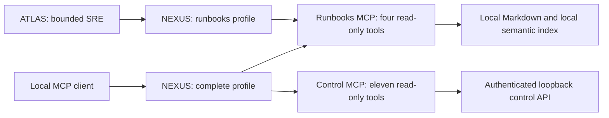

# NEXUS: the local MCP gateway

NEXUS is a service, not an autonomous agent. It routes the repository's two
trusted MCP backends over **stdio**, without opening a port. The checkout's
`.mcp.json`, the ATLAS SRE client and the readiness probes all use this entrypoint.
No global editor, Codex or third-party plugin configuration is changed.



## Installation and connection

From the checkout root, install the locked runtimes before connecting a client:

```sh
uv sync --locked --project mcp-servers/runbooks
uv sync --locked --all-extras --project agents/sre-agent
uv sync --locked --project apps/control-api
./plateforme preparation
```

Configure the client to use the single `plateforme` entry in `.mcp.json`, with
the checkout root as its working directory. The equivalent stdio command is:

```sh
uv run --locked --project apps/control-api python -m plateforme.passerelle
```

This is a protocol process: ordinary terminal output is not its interface.
The private operator configuration remains in the checkout's owner-only `.env`.
The complete profile reads it without printing values. The runbooks subprocess
receives only its local connection settings and `CONFIDENTIAL_KEY`; the control
subprocess loads the existing API credential itself and uses authenticated GETs
against the fixed loopback API. Proxy variables and unrelated provider keys are
not forwarded. Installation can download pinned dependencies; tool calls have no
new external destination.

The optional `--profil runbooks` and `--profil controle` launch only their named
backend. ATLAS always selects `runbooks` and passes an already-filtered environment;
this gateway profile does not read the control plane's `.env`. Readiness uses both
restricted profiles independently, initializes real MCP sessions and lists tools.
It does not invoke tools or prove semantic-search quality by listing them.

## Published tools and authority

| Namespace | Allowed public tool names |
|---|---|
| `runbooks__` | `list_runbooks`, `read_runbook`, `search_runbooks`, `semantic_search` |
| `controle__` | `plateforme_sante`, `plateforme_analyses`, `plateforme_runbooks`, `plateforme_analyse`, `plateforme_lire_runbook`, `plateforme_recherche`, `plateforme_preparation`, `plateforme_outils`, `plateforme_journal`, `plateforme_memoire`, `plateforme_note_memoire` |

For example, the public name is `runbooks__read_runbook`. Existing catalogue
identifiers remain stable; `/api/outils` adds `mcp_nom` and `mcp_serveur` for these
15 tools. Memory reads require an explicit scope; notes are unverified context.
Voice and operations are not exposed through MCP. The gateway has no
execution, approval, file-write, arbitrary URL, arbitrary subprocess, dynamic
plugin or backend-registration tool. Human decisions remain in the authenticated
UI/CLI. ATLAS translates its four public names back to the existing internal tool
names and presents only those four schemas to the model. Extraction and
classification do not receive the entire operator catalogue.

Namespaces prevent backend name collisions. Unknown tools are omitted. Duplicate
names, paginated/oversized inventories, task execution capabilities or allowed
tools lacking explicit read-only/non-destructive/closed-world annotations make
that backend unavailable. Standard titles, descriptions, input/output schemas and
annotations are retained; arbitrary icons, extension metadata, resources,
prompts and task capabilities are not relayed. Backend result text is still
untrusted source data, not an instruction. Existing source hashes, passage checks,
truncation refusal and human approval remain necessary.

## Bounds, failure and cleanup

- Initialization plus inventory: 15 seconds per backend, in parallel.
- One active call per backend per gateway connection; an overlapping call to the
  same backend is refused immediately. The other backend remains available.
- Tool call: 125 seconds; timeout closes that backend session. Reconnect the MCP
  client to start a new session. Calls are not silently retried.
- Parsed arguments: 16,384 UTF-8 JSON bytes. Inventory: at most 32 entries and
  65,536 bytes. Parsed result envelope: 1,000,000 bytes, text/structured JSON only.
  ATLAS additionally limits individual tool text to 12,000 characters and its
  total serialized message context to 100,000 characters.
- Backend exception details and stderr are suppressed. A caller receives a
  generic bounded error. EOF, cancellation and SIGTERM close child sessions;
  client cancellation is propagated to the backend request.

These limits apply to decoded MCP objects, not to raw wire frames before the SDK
parses them. Stdio access is controlled by local process ownership; there is no
HTTP endpoint needing another authentication system. Child processes run as the
operator and can read files allowed to that OS user: profiles restrict the tool
surface and forwarded credentials, **not** OS file access. This is not a sandbox
for untrusted backend executables. SIGKILL/host failure cannot run Python cleanup.
Multiple independent clients create independent processes and concurrency limits.

## Observed SRE token and cost budgets

`SRE_MAX_TOKENS_TOTAL` is an integer between 1 and 1,000,000, default 60,000. For
UI/CLI jobs set it in the existing private checkout `.env`; the control plane
forwards that setting to the SRE process. Standalone SRE commands read their
process environment. `/api/parametres` exposes `budget_tokens_total` for the next
job, or `null` for an invalid setting; invalid SRE configuration refuses startup.
The UI does not edit environment files. Existing running jobs keep their own
process configuration; a resumed graph uses the then-current configured ceiling.

The budget sums provider-reported prompt/completion tokens across the run,
including checkpointed steps. At the limit it refuses the next dispatch. An
answer crossing the limit is accounted for and stops the run. The final call can
therefore overshoot: this is an **observed ceiling, not a predicted hard quota**.
Input tokenization is not estimated. `max_tokens` per completion is bounded to
6,000; the existing turn, tool-call, context, monetary and duration limits remain.
If the provider omits usage, the token limit cannot account for that unknown work.

The report preserves legacy fields and adds measurement coverage:

| Field | Meaning |
|---|---|
| `appels_llm` / `appels_llm_tentes` | Accounted responses / attempted HTTP dispatches, including interrupted requests |
| `tokens_entree`, `tokens_sortie`, `tokens_total` | Observed sums; `null` after attempts with no corresponding measurement |
| `tokens_disponibles`, `usage_complet` | At least one known token counter / both directions known for every attempt |
| `appels_mesures_entree`, `appels_mesures_sortie`, `appels_mesures_tokens` | Number of attempts with input, output or both counters reported |
| `max_tokens_total` | Configured observed ceiling |
| `cout_usd`, `cout_disponible`, `usage_cout_complet`, `appels_mesures_cout` | Reported API cost sum, availability and attempt coverage |

Partial sums are lower bounds. A genuine reported zero is available; missing
usage or a missing local API cost header is unknown, not free. Reported API cost
does not measure local hardware or electricity. Historical checkpoints preserve
known sums but do not acquire invented measurement completeness. Counters must be
non-negative integers, without accepting booleans, strings or fractional values.
Failed/malformed responses retain attempt accounting without fabricated usage.

## Verification

```sh
cd apps/control-api
uv run --locked pytest -q tests/test_passerelle.py tests/test_parametres_budget.py
cd ../../agents/sre-agent
uv run --locked pytest -q tests/test_budget_tokens.py tests/test_mcp_transport.py
```

The gateway suite uses real SDK clients, real stdio subprocesses, both production
backend implementations and an isolated authenticated loopback API. It checks
metadata, namespace filtering, schema preservation, limits, collision refusal,
backend failure isolation, concurrency, cancellation and child-process cleanup.
Fixtures contain synthetic data and do not call a model. These tests do not
certify every third-party MCP client or production security of the whole stack.

Protocol references: MCP [lifecycle](https://modelcontextprotocol.io/specification/2025-11-25/basic/lifecycle)
and [tools](https://modelcontextprotocol.io/specification/2025-11-25/server/tools).
See [ADR 0022](adr/0022-passerelle-mcp-locale.md), the
[operator tools guide](TOOLS.md) and [security release assessment](SECURITY-RELEASE-2026-09-26.md).
